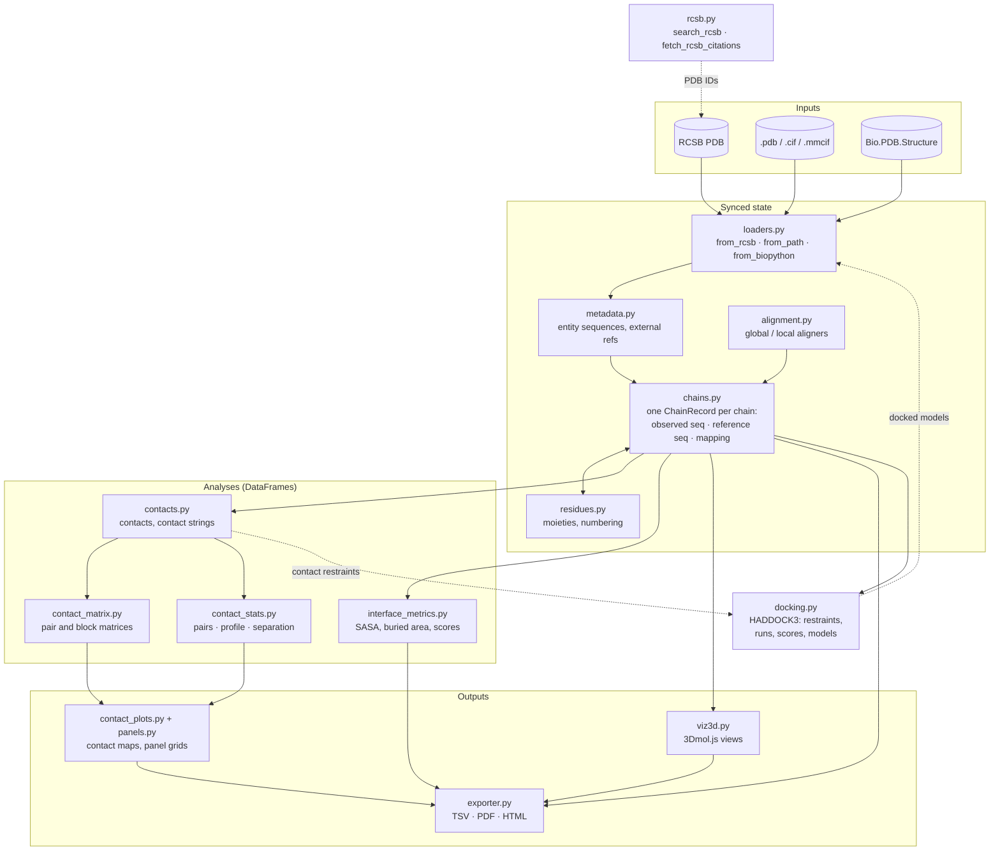

# synced_structure

A Biopython structure wrapper that keeps every observed residue linked to its position in the reference sequence, and builds contacts, contact maps, interface metrics, HADDOCK3 dockings, tables and 3D views on top of that link.

## Why this package exists

A deposited structure is an incomplete copy of a biological sequence. Disordered loops and termini are not modelled, author numbering can start anywhere, and every chain has two IDs (author and label) that often differ. The STAT6–DNA complex [5D39](https://www.rcsb.org/structure/5D39) shows all of it:

- **Different gaps per copy.** The four STAT6 chains share one 539-residue sequence but model 489, 484, 484 and 487 residues, each missing different ones. Position 100 of chain A's observed sequence is not the same residue as position 100 of chain B's.
- **Three numbers for one residue.** The first modelled residue of chain A has author number 125, observed position 1 and reference position 6.
- **Two IDs per chain.** The DNA strand with label ID `E` has author ID `N`, while author ID `E` is a different strand. Mixing the two picks the wrong chain without any error.

Biopython parses the file, MDTraj computes distances, RCSB serves the metadata; none of them keeps the observed → reference correspondence for you. When you rename a chain, change a reference or renumber, it silently goes stale and tables end up indexed by something other than what you think.

`synced_structure` keeps that correspondence, one mapping per chain, and rebuilds it on every operation that could break it. Every table reports observed and reference numbering and both chain IDs.

## Design principles

1. **Wrap, don't fork.** The Biopython structure stays reachable as `.structure`; everything Biopython does still works.
2. **One mapping per chain, kept in sync.** Built by global alignment and rebuilt whenever a chain, reference or numbering changes.
3. **Both chain IDs are kept.** Chains are keyed by author or label IDs (`key_by`), and tables always report both.
4. **Tables first, figures second.** Every analysis returns a `pandas.DataFrame`; figures are drawn from the same tables.

## How it fits together



`SyncedStructure` (`structure.py`) combines one mixin per area; they all share the state declared in `base.py`. The words used here (chain key, label/author ID, reference index, moiety…) are defined in [Concepts](docs/concepts.md).

## Installation

Requires Python ≥ 3.10.

```bash
pip install "git+https://github.com/ssenci97/bio-utils-2.git"              # latest
pip install "git+https://github.com/ssenci97/bio-utils-2.git@v0.1.0"       # this release
pip install "synced_structure[haddock] @ git+https://github.com/ssenci97/bio-utils-2.git"   # with HADDOCK3
```

If `pip` cannot build `mdtraj`, install it from conda-forge first: `conda install -c conda-forge mdtraj`. For development, see [Development](docs/development.md).

| Package | Used for |
|---|---|
| `biopython` | Parsing, structure objects, alignment, SASA |
| `numpy`, `pandas` | Numerics and every returned table |
| `mdtraj` | Residue–residue distances |
| `matplotlib` | Contact maps, panel grids, PDF export |
| `pyyaml`, `requests`, `tqdm`, `ipython` | Configuration, RCSB access, progress bars, Jupyter 3D views |
| `haddock3` *(optional)* | Docking ([guide 6](docs/guides/06-docking.md)) |

The 3D viewer loads [3Dmol.js](https://3dmol.org) from the web when displayed, so it needs a browser with internet access.

## Quick start

```python
from synced_structure import SyncedStructure

s = SyncedStructure.from_rcsb("1AAY")     # Zif268 zinc fingers bound to DNA
s.chain_summary()                         # chains, both IDs, entities, references, coverage
s.get_residue_mapping("A")                # author number ↔ observed index ↔ reference index
s.compute_contacts()                      # inter-chain residue contacts (nm)
s.interface_complex("A", "B")             # buried area and interface metrics (Å)
s.plot_contact_map("A", "B", crop=True)   # contact map
s.show_structure_3d()                     # interactive 3D view in Jupyter
```

New here? Follow [1. Getting started](docs/guides/01-getting-started.md): it explains each of these lines and what to expect from it.

## Documentation

| Page | Read it to… |
|---|---|
| [Concepts](docs/concepts.md) | learn the definitions and see the numbering and ID diagrams |
| [1. Getting started](docs/guides/01-getting-started.md) | install, load, see chains, find contacts, first map |
| [2. Chains and numbering](docs/guides/02-chains-and-numbering.md) | address chains safely; reference sequences, renumbering, renaming |
| [3. Contacts](docs/guides/03-contacts.md) | contacts, contact strings, matrices, statistics, contact maps |
| [4. Interfaces](docs/guides/04-interfaces.md) | buried surface, interface residues and partners |
| [5. Export](docs/guides/05-export.md) | tables, figures, panel grids, 3D pages |
| [6. Docking with HADDOCK3](docs/guides/06-docking.md) | set up, run and read back a docking |
| [API index](docs/api_index.md) | every method, argument and configuration key |
| [Development](docs/development.md) | conventions, tests and checks |
| [Changelog](CHANGELOG.md) | what is in each version |

Every guide's code is run by the test suite, so it works as written.

## Example script

[`examples/export_all.py`](examples/export_all.py) downloads [6R3Q](https://www.rcsb.org/structure/6R3Q) (adenylyl cyclase 9 bound to Gαs) and writes every table, contact maps and a 3D page to `examples/output/`:

```bash
python examples/export_all.py
```

## Tests

```bash
pip install -e ".[dev]"
pytest -m ""      # everything: offline, network, haddock3, documentation and typing checks
```

See [Development](docs/development.md#tests) for what each test layer checks.
