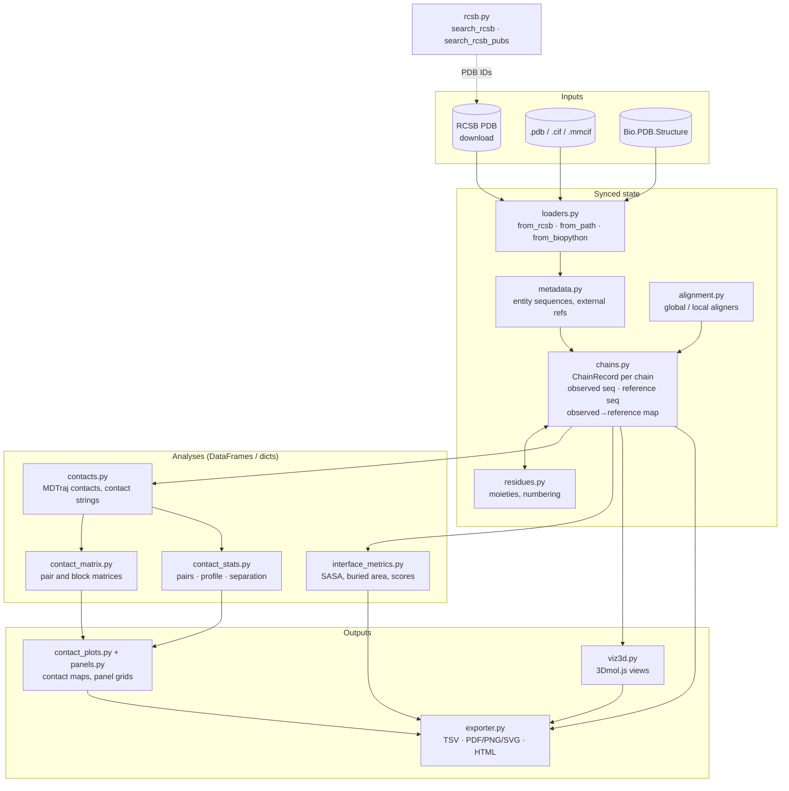

# synced_structure

A Biopython structure wrapper that keeps every observed residue linked to its position in the reference sequence, and computes contacts, contact maps, interface metrics, tables and 3D views on top of that link.

## Why this package exists

A deposited structure is an incomplete copy of a biological sequence, not the sequence itself. Disordered loops and termini are not modelled. Author numbering is chosen by the depositors and can start anywhere, skip numbers or use insertion codes. Every chain has two IDs, an author ID and a label ID, and they often differ. Protein, nucleic acid, ligands, ions and water share the same chain records.

The STAT6–DNA complex [5D39](https://www.rcsb.org/structure/5D39), used in the example script, shows all of these:

- **Different gaps per copy.** The four STAT6 chains share one 539-residue entity sequence. A, B, C and D model 489, 484, 484 and 487 residues, and each copy misses a different set of residues. Position 100 of the observed sequence of A is therefore not the same residue as position 100 of B, and contacts or interface residues cannot be compared between copies by observed index.
- **Three numberings for one residue.** The first modelled residue of chain A has author number 125. It is position 1 of the observed sequence and position 6 of the reference sequence.
- **Author and label IDs disagree.** The DNA strand with label ID `E` has author ID `N`, and author ID `E` belongs to a different strand, with label ID `G`. Code that mixes the two ID systems picks the wrong chain without raising an error.

Biopython parses the file and stores what was observed. MDTraj computes distances. RCSB serves the entry and its metadata. None of them keeps the observed→reference correspondence for you. If you rename a chain, swap in a model, change a reference sequence or renumber residues, you have to rebuild that correspondence yourself. If you forget, contact maps, interface tables and figures end up indexed by something other than what you think. Usually nothing fails, and the numbers are just wrong.

`synced_structure` maintains this correspondence. On load it aligns each chain's observed sequence to its reference: the full mmCIF entity sequence, or one you supply. It stores the result as one mapping per chain and rebuilds the mapping on every operation that could invalidate it. Every table reports observed and reference numbering and both chain IDs, so the output is unambiguous when it is read later or by someone else.

The package does not replace Biopython, MDTraj or the RCSB APIs. They are more general and better tested, and this package uses them underneath.

## Design principles

1. **Wrap, don't fork.** The underlying `Bio.PDB.Structure` stays reachable as `.structure`. Anything Biopython can do still works, and `SyncedStructure` adds the mapping and the analyses on top.
2. **One mapping per chain, kept in sync.** Each chain has a single observed→reference map, built by global alignment. Changing a reference, renaming, replacing or removing a chain, or renumbering residues updates that map instead of leaving it stale.
3. **Both chain IDs are kept.** A chain can be addressed by its key, its label ID (`chain_id`) or its author ID (`auth_chain_id`). `key_by` chooses which one is the key, and tables always report both. Nothing assumes author numbering.
4. **Tables first, figures second.** Every analysis returns a `pandas.DataFrame` or a dict, and every table can be exported. Plots and 3D views are built from the same tables, so a figure matches the numbers behind it.

`SyncedStructure` is one class assembled from mixins, one per area: loading, metadata, chains, alignment, residues, contacts, contact matrices, contact statistics, plots, interfaces, export and 3D. All of them read and write the same `chains` state. Mutating methods return `self`, so calls can be chained.

## Package layout



The modules `constants.py`, `plot_style.py`, `sequence.py` and `utils.py` hold shared constants, plot styling, sequence helpers and logging. `structure.py` combines the mixins into `SyncedStructure`.

## Installation

Requires Python ≥ 3.10.

Install from GitHub:

```bash
pip install "git+https://github.com/ssenci97/bio-utils-2.git"
pip install "git+https://github.com/ssenci97/bio-utils-2.git@main"   # pin a branch, tag or commit
```

Or clone for development. Use an editable install (`-e`), so that tests and scripts import the code in `src/` and not a stale copy in `site-packages`:

```bash
git clone https://github.com/ssenci97/bio-utils-2.git
cd bio-utils-2
pip install -e .            # library only
pip install -e ".[dev]"     # library + pytest
```

`mdtraj` ships compiled extensions. If `pip` cannot build it on your platform, install it from conda-forge first:

```bash
conda install -c conda-forge mdtraj
pip install -e .
```

### Dependencies

| Package | Used for |
|---|---|
| `biopython>=1.80` | Parsing PDB/mmCIF, structure objects, sequence alignment, Shrake–Rupley SASA |
| `numpy`, `pandas` | Numerics and the tables every analysis returns |
| `mdtraj` | Residue–residue distances and contacts |
| `matplotlib` | Contact maps, multi-chain contact plots, panel grids, PDF export |
| `pyyaml` | Optional YAML configuration |
| `requests` | Downloading entries and querying the RCSB Search and Data APIs |
| `tqdm` | Progress bars |
| `ipython` | Inline 3D views in Jupyter |
| `pytest` *(dev)* | Test suite |

The 3D viewer loads [3Dmol.js](https://3dmol.org) from the 3Dmol.org website when the view is displayed, so it needs a browser with internet access. It needs no Python package.

## Quick start

```python
from synced_structure import SyncedStructure, search_rcsb

s = SyncedStructure.from_rcsb("4HHB")
s.summary()                        # chains, entities, references, coverage
s.get_residue_mapping("A")         # author number ↔ observed index ↔ reference index
s.contact_matrix("A", "B")         # inter-chain contact map data
s.interface_complex("A", "B")      # interface metrics
s.plot_contact_map("A", "B")
s.show_structure_3d(style="cartoon")   # 3D view in Jupyter

hits = search_rcsb(organisms=["Homo sapiens"], keywords=["hemoglobin"], resolution_max=2.0)
```

## Example script

[`examples/export_all.py`](examples/export_all.py) downloads 5D39 and writes every table (TSV), several figures (PDF, PNG, SVG), a multi-page PDF of contact maps for all interacting chain pairs, and two 3D views (standalone HTML) to `examples/output/`:

```bash
python examples/export_all.py
```

## API reference

### Construction

```python
SyncedStructure(structure, structure_id="structure", mmcif_dict=None, file_format="cif",
                config_path=None, default_entity_id=None, key_by="auth")
SyncedStructure.from_rcsb(pdb_id, config_path=None, key_by="auth")
SyncedStructure.from_path(path, config_path=None, key_by="auth")          # .pdb, .cif, .mmcif
SyncedStructure.from_biopython(structure, structure_id=None, mmcif_dict=None, file_format="pdb",
                               config_path=None, key_by="auth")
```

Attributes: `structure`, `model`, `structure_id`, `file_format`, `mmcif_dict`, `config`, `key_by`, `chains`.

### Chains and references

| Method | Purpose |
|---|---|
| `chain_ids` *(property)* | Loaded chain keys |
| `summary()` | Label/author IDs, entity, polymer moiety, description, external ref, refseq ID, coverage |
| `get_sequence(chain_id)` / `get_reference_sequence(chain_id)` | Observed / reference sequence |
| `set_reference_sequence(chain_id, sequence, remap=True)` | Replace one reference |
| `set_reference_sequences(sequences, remap=True)` | Replace several references from `{chain: seq}` |
| `remap_chain(chain_id)` / `remap_all_chains()` | Rebuild mappings |
| `get_external_ref(chain_id)` / `set_external_ref(chain_id, ref)` | Accession, for example UniProt |
| `get_refseq_id(chain_id)` / `set_refseq_id(chain_id, ref)` | ID of the reference sequence; falls back to the external ref |
| `set_entity_id(chain_id, entity_id)` / `set_chain_metadata(chain_id, key, value)` | Annotate a chain |
| `add_chain(chain, reference_sequence=None, entity_id=None, metadata=None, replace=False)` | Add a chain |
| `replace_chain(chain_id, chain, ...)` / `remove_chain(chain_id)` | Replace or remove a chain |
| `match_chains(sequence, min_identity=90.0)` | Find chains matching a sequence |
| `rename_chains(mapping)` / `rename_by_sequence(targets, min_identity=90.0)` | Rename chains and keep the mapping in sync |
| `chain_contact_partners(cutoff=..., moieties=...)` | `{chain: [partners]}` |

### Alignment

`alignment_stats` *(property)*: local alignment statistics per chain. `alignment_positions` *(property)*: the alignment column by column.

### Residues

| Method | Purpose |
|---|---|
| `get_residue_mapping(chain_id)` | `pdb_resnum` ↔ `sequence_index` ↔ `reference_index` |
| `residue_map` / `moiety_summary` *(properties)* | All residues; residue counts per chain and moiety |
| `chains_by_moiety(moiety)` | Chains containing `protein`, `nucleic`, `ligand`, `ion` or `water` |
| `apply_reference_numbering(chain_ids=None)` | Trim unmapped residues and renumber by reference, in place |
| `reindex_chain(chain_id, in_place=False)` | Renumber 1..N |

### Contacts

Contacts are computed with MDTraj using the `"ca"` scheme (one point per residue: Cα for protein, C4′ for nucleic acids, the heavy-atom centroid for ligands and ions) or the `"sidechain"` scheme (closest heavy atom).

```python
to_ca_trajectory(chain_ids=None, moieties=...)
compute_contacts(cutoff=..., contact_type=..., chain_ids=None, scheme="ca", moieties=...)
get_contact_sequence(chain_id, ...) / get_reference_contact_sequence(chain_id, ...)
export_contact_sequences(output_path, ..., reference=False, ...)
contact_matrix(chain_a="A", chain_b=None, cutoff=..., moieties=..., scheme="ca")
block_contact_matrix(chain_a="A", chain_b="B", ..., min_separation=...)
contact_statistics(cutoff=..., moieties=..., scheme="ca")   # dict: pairs, profile, separation, moiety_pairs
```

### Interfaces

`interface(a, b)`, `interface_all(chain_pairs=None)`, `interface_complex(a, b)`, `interface_residues(a, b)`, `chain_partner_interfaces(chain_id, cutoff=...)` and `chain_partner_frame(chain_id, cutoff=..., level="complex")`. The scalar metrics `buried_area`, `initial_sasa`, `buried_fraction`, `contact_count`, `min_distance` and `contact_score`, and `interface_partner_labels`, all take `(chain_a="A", chain_b="B")`.

### Visualization

`plot_contact_map(chain_a="A", chain_b=None, ...)`, `plot_contacts_multi(chain_ids=("A", "B"), ..., plddt=False, ...)`, `plot_contact_panel(chain_a="A", chain_b=None, ...)` and `show_structure_3d(angles=(0, 0, 0), chain_id=None, colors=None, title=None, style="cartoon", ...)`.

### Export

Tables are written as TSV, named `{structure_id}_{name}.tsv`. All of these take `outdir=None`, which defaults to the configured `save_outdir`:

- **Tables:** `export_chains`, `export_residue_mapping(chain_ids=None)`, `export_residues`, `export_moieties`, `export_alignment_stats`, `export_alignment_positions`, `export_interface_complex(chain_pairs=None)` and `export_interface_residues(chain_pairs=None)`.
- **Figures:** `export_plot(plot_func, name, formats=..., dpi=..., raster=True)` and `export_plot_grid(plot_funcs, name, ...)`.
- **3D view:** `export_structure_3d(name="structure_3d", title=None, **view_kwargs)` writes `show_structure_3d` as a standalone HTML page.

### Module-level functions

```python
from synced_structure import search_rcsb, search_rcsb_pubs, build_panel_grid, export_panels_pdf, side_by_side

search_rcsb(organisms=None, keywords=None, title_contains=None, keywords_field=None,
            experimental_method=None, resolution_max=None, resolution_min=None,
            release_date_from=None, release_date_to=None, polymer_entity_count_min=None,
            polymer_entity_count_max=None, uniprot_ids=None, enzyme_classification=None,
            return_type="entry", max_rows=10000, return_all_hits=False,
            include_computational=False, sort_by="score", sort_direction="desc", timeout=30)
search_rcsb_pubs(df, id_col="pdb_id", primary_only=True, merge=True, batch_size=200, timeout=30)
build_panel_grid(plot_funcs, sizes=3.0, ncols=2, panel_labels=True, main_title=None, wspace=0.06, hspace=0.06)
export_panels_pdf(grids, outdir, filename=..., raster=True, dpi=..., **grid_kwargs)
side_by_side(*outputs, gap_px=...)
```

### Deprecated aliases

These still work but emit a `DeprecationWarning`: `jupy_viz` → `show_structure_3d`, `complete_contacts` → `block_contact_matrix`, `partners` → `interface_partner_labels`.

## Configuration

All constructors accept an optional `config_path` pointing to a YAML file. Values are read from the `synced_structure` section. Missing keys fall back to the defaults, and the file is never written.

```yaml
synced_structure:
  save_outdir: data/saved          # default output directory for exports
  aln_match_score: 1
  aln_mismatch_score: -1
  aln_open_gap_score: -2
  aln_extend_gap_score: -0.5
  interface_contact_cutoff_a: 4.5  # Å
  interface_score_cutoff_a: 12.0   # Å
  interface_block_size: 1000
```

## Tests

```bash
pytest                 # offline tests (default)
pytest -m network      # tests that call live RCSB services
```
