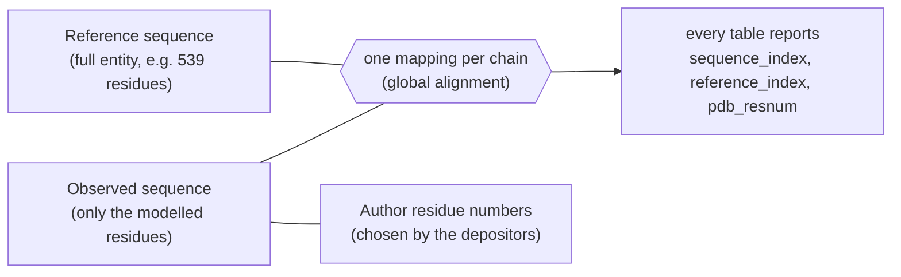
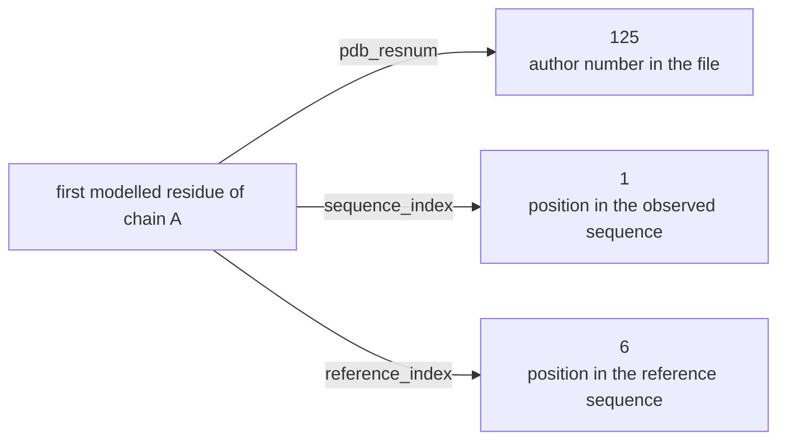
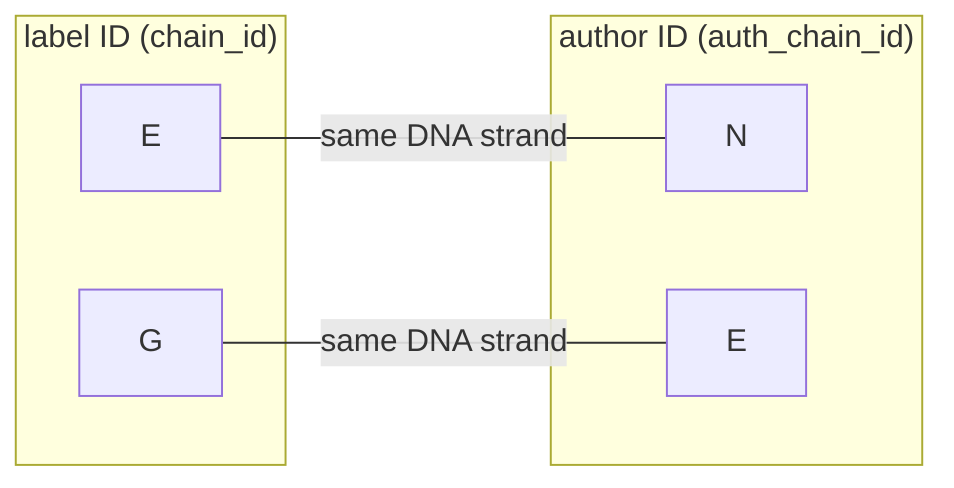
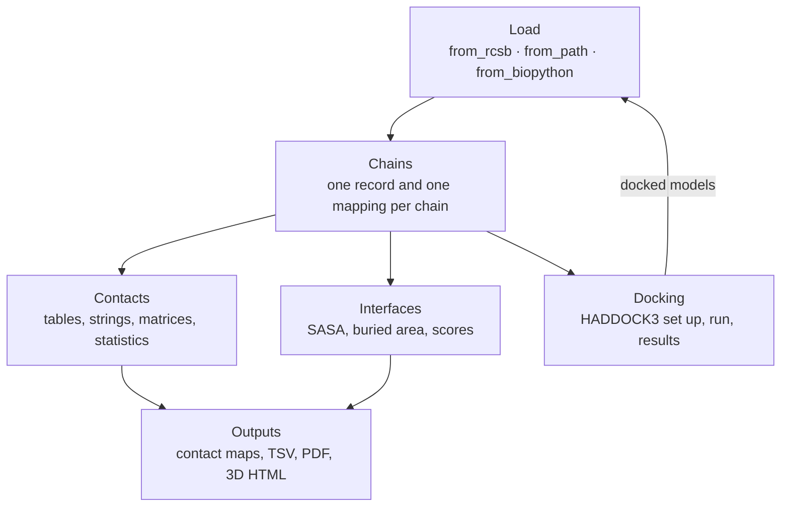

# Concepts

This page defines the words used throughout `synced_structure` and shows, with diagrams, how one residue and one chain can be named in several ways. Read it once before the [guides](guides/); every guide links back here.

## The problem in one picture

A deposited structure is an incomplete copy of a biological sequence. Some residues are not modelled, numbering is chosen by the depositors, and every chain has two IDs. `synced_structure` keeps all of these names linked.

## One residue, three numbers

Chain A of the STAT6–DNA complex [5D39](https://www.rcsb.org/structure/5D39) starts after five disordered residues. Its first modelled residue has three different numbers:

Use `reference_index` to compare residues between chains, structures or models: it is the only number that means the same residue everywhere. All three are 1-based in every table.

## One chain, two IDs

mmCIF files give every chain a **label ID** (assigned by the PDB) and an **author ID** (chosen by the depositors). They often differ, and the same letter can name different chains:

In 5D39, asking for chain "E" gives a different strand depending on which ID system you mean. `synced_structure` keys chains by one system (`key_by`) and reports both IDs in every table.

## Glossary

| Term | Meaning |
|---|---|
| **chain key** | The name a chain is stored under: its author ID by default (`key_by="auth"`), or its label ID (`key_by="label"`). `s.chain_ids` lists the keys. |
| **label ID** (`chain_id`) | The chain ID assigned by the PDB (`label_asym_id` in mmCIF). |
| **author ID** (`auth_chain_id`) | The chain ID chosen by the depositors (`auth_asym_id`); the one shown by most viewers. |
| **chain reference** | Anything a method accepts as `chain_id`: a key, a label ID or an author ID. Keys are matched first. |
| **observed sequence** | One-letter sequence of the residues actually present in the file (`get_sequence`). |
| **reference sequence** | The full sequence of the chain's entity from the mmCIF file, or one you set (`get_reference_sequence`, `set_reference_sequence`). |
| **mapping** | The observed → reference correspondence of a chain, built by global alignment and rebuilt whenever it could change. |
| `pdb_resnum` | Author residue number, as written in the file. |
| `sequence_index` | 1-based position in the observed sequence. |
| `reference_index` | 1-based position in the reference sequence; empty when a residue has no counterpart. |
| **moiety** | The type of a residue: `protein`, `nucleic`, or `other` (ligands, ions and water). |
| **polymer residue** | A `protein` or `nucleic` residue; only these appear in sequences and mappings. |
| **contact point** | One point per residue used by the `ca` scheme: Cα for protein, C4′ for nucleic acids, the heavy-atom centroid for `other`. |
| **contact scheme** | `ca`: distance between contact points. `sidechain`: closest heavy atom of side chains (protein) or bases (nucleic). |
| **contact type** | `inter` (between chains), `intra` (within a chain) or `all`. |
| **contact string** | One character per residue: `1` in contact, `0` not in contact, `X` no contact point or no residue. |
| **interface** | The residues of two chains that bury surface against each other, measured with heavy atoms (SASA, distances, scores). |
| **partner** (docking) | One rigid body in a HADDOCK3 docking; it may hold several chains. |

## Units

| Quantity | Unit | Where |
|---|---|---|
| Contact cutoffs and distances | **nm** | `compute_contacts`, contact matrices, contact maps, `cutoff=` arguments of contact methods |
| Interface distances and areas | **Å**, **Ų** | `interface_*` metrics, `interface_min_distance_a`, `clearance_a` in docking |

## How the pieces fit

Every analysis returns a `pandas.DataFrame` (or a dict of them), and every figure is drawn from those tables.
