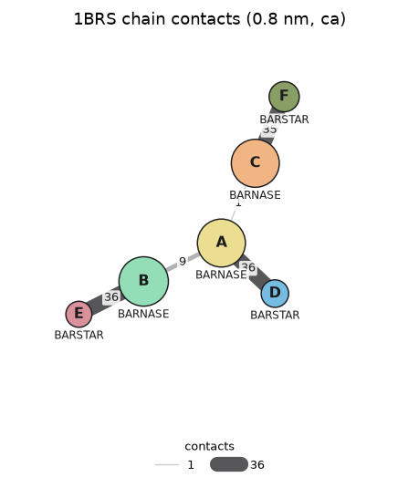

# Structure comparison

Compare a structure (the **model**) with a **reference**: which residues correspond, how far apart they are after an optimal superposition (RMSD), and, for complexes, the CAPRI quality metrics used to judge docking. Every distance is in **Å**. The chain contact graph gives an overview of which chains of an entry touch, and how much.

## Matched residues

Methods are called on the model and take the reference as first argument. Chains pair by key unless you pass `chain_map={model chain: reference chain}`. Residues match through their reference positions, so different entries of the same protein compare even when their numbering, tags or lengths differ; when the reference sequences differ, through a global alignment of them.

```python
from synced_structure import SyncedStructure

complex_ = SyncedStructure.from_rcsb("1BRS")     # barnase A, B, C with barstar D, E, F
barnase = SyncedStructure.from_rcsb("1A2P")      # barnase alone, another entry

barnase.residue_match_table(complex_, chain_map={"A": "A"}).head()
```

## RMSD and superposition

`rmsd_metrics` superposes the matched atoms (Kabsch) and returns the RMSD with the rotation and translation; nothing moves. `atoms` is `"ca"` (Cα, P for nucleic acids), `"backbone"` or `"heavy"`. `fit_chains` superposes on some chains and measures others. `apply_superposition` moves the model onto the reference and returns it, so calls chain.

```python
barnase.rmsd_metrics(complex_, chain_map={"A": "A"})["rmsd_A"]
barnase.rmsd_metrics(complex_, chains="A", chain_map={"A": "B"}, atoms="backbone")["rmsd_A"]

barnase.apply_superposition(complex_, chain_map={"A": "A"})
barnase.rmsd_metrics(complex_, chain_map={"A": "A"}, superpose=False)["rmsd_A"]   # same RMSD, no fit needed now
```

`show_superposition_3d(reference)` draws a superposed copy of the model over the reference (grey) in one 3D view, with the RMSD in the title:

```python
barnase.show_superposition_3d(complex_, chain_map={"A": "A"})
```

## CAPRI metrics of a complex

`capri_metrics` scores a model of a complex against the reference complex with the CAPRI and DockQ definitions:

| Column | Meaning |
|---|---|
| `fnat` | Fraction of the reference receptor-ligand residue contacts (heavy atoms within 5 Å) present in the model. |
| `fnonnat` | Fraction of the model contacts that are not in the reference. |
| `irmsd_A` | Backbone RMSD of the interface residues (within 10 Å of the other partner in the reference), superposed on them. |
| `lrmsd_A` | Ligand backbone RMSD after superposing the receptor backbone. |
| `rmsd_A` | Backbone RMSD of both partners. |
| `dockq` | (Fnat + 1/(1+(i-RMSD/1.5)²) + 1/(1+(l-RMSD/8.5)²)) / 3, from 0 to 1. |
| `capri_class` | `high`, `medium`, `acceptable` or `incorrect`. |

Backbone atoms are N, Cα, C, O for proteins and P, O5′, C5′, C4′, C3′, O3′ for nucleic acids. On protein-protein complexes the values agree with haddock3's `caprieval` to within 0.05 Å. For DNA, `caprieval` uses base atoms instead, so its values differ.

```python
model = complex_.subset_chains(["B", "E"], structure_id="B_E")   # the second copy, as a model of A-D
model.capri_metrics(complex_, receptor="B", ligand="E", chain_map={"B": "A", "E": "D"})
```

`capri_table` scores several models against the reference, best DockQ first. Models can be structures or file paths, such as the docked models of a [HADDOCK3 run](docking.md):

```python
complex_.capri_table({"B_E": model}, receptor="B", ligand="E", chain_map={"B": "A", "E": "D"})
```

## Chain contact graph

`plot_chain_graph` draws the chains as nodes, colored as in the 3D views and sized by residue count, joined by edges as thick and dark as the number of residue contacts between them; `chain_graph_table` holds the counts. For any PDB entry:

```python
fig, ax = SyncedStructure.from_rcsb("1BRS").plot_chain_graph()
```



Contacts use the contact points of the [contact tables](../reference/contacts.md) (`cutoff` in nm, default 0.8). With the default `scheme="ca"` the counts are computed chain pair by chain pair in bounded memory, so large assemblies work too; `scheme="sidechain"` goes through `contact_table` and is slower. `layout="circular"` places the chains on a circle; `min_contacts` hides weak edges.
