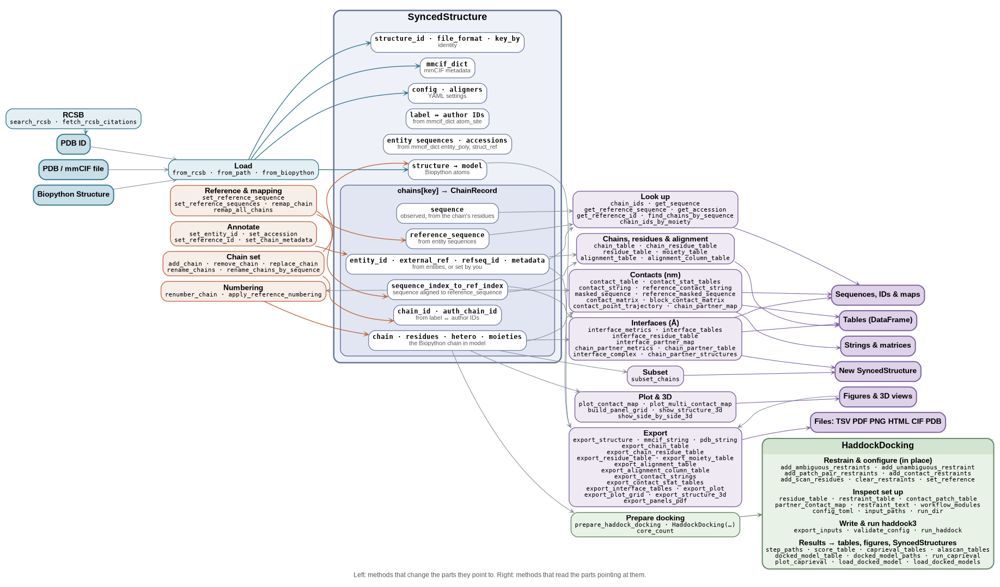

# API reference

Everything public is importable from the package:

```python
from synced_structure import (
    SyncedStructure, HaddockDocking,                 # classes
    build_panel_grid, export_panels_pdf,             # panel figures
    show_side_by_side_3d,                            # 3D views
    search_rcsb, fetch_rcsb_citations,               # RCSB services
    core_count,                                      # usable CPU cores
)
```

The pages follow the analysis pipeline. All `SyncedStructure` methods are called on a loaded structure.

| Step | Page | Main entry points |
|---|---|---|
| Load | [Structure and loading](structure.md) | `from_rcsb`, `from_path`, `from_biopython` |
| Inspect and edit chains | [Chains](chains.md) | `chain_table`, `set_reference_sequence`, `rename_chains`, `subset_chains` |
| Numbering | [Residues and alignment](residues.md) | `chain_residue_table`, `apply_reference_numbering`, `alignment_table` |
| Contacts (nm) | [Contacts](contacts.md) | `contact_table`, `contact_string`, `contact_matrix`, `contact_stat_tables` |
| Interfaces (Å) | [Interfaces](interfaces.md) | `interface_complex`, `interface_residue_table`, `interface_tables` |
| Figures | [Plots and 3D views](plots.md) | `plot_contact_map`, `plot_multi_contact_map`, `show_structure_3d` |
| Files | [Export](export.md) | `export_structure`, `export_chain_table`, `export_contact_stat_tables`, `export_plot` |
| Docking | [Docking](docking.md) | `prepare_haddock_docking`, `HaddockDocking`, `core_count` |
| Find structures | [RCSB](rcsb.md) | `search_rcsb`, `fetch_rcsb_citations` |

Names say what they return; the grammar is in [Conventions](../guide/conventions.md).

## Operations map

What a `SyncedStructure` is made of, and every public method. The middle cluster shows its parts, with the `ChainRecord` of each chain nested inside. Each part's subtitle says what it is built from. Method groups on the left change the parts they point to. Groups on the right read the parts that point at them and lead to what they return. `HaddockDocking` lists its own method groups.


